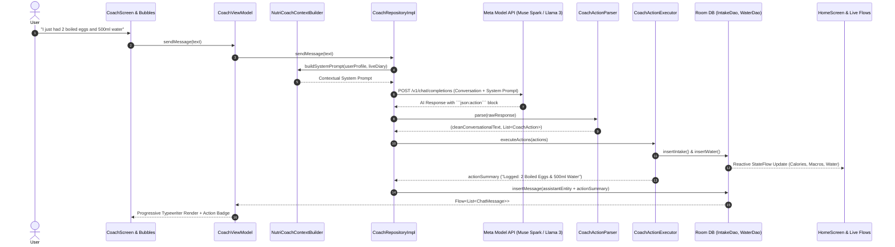

# NutriMind AI 🥗🧠
> **Smart Multimodal Nutrition & Wellness Coach Powered by Meta AI**  
> *Submitted to the [Meta Global AI Developer Hackathon 2026](https://meta.ai) — Indie Developer Track ($400,000 Prize Pool)*

[](https://developer.android.com)
[](https://kotlinlang.org)
[](https://developer.android.com/jetpack/compose)
[](https://api.meta.ai)
[](LICENSE)

---

## 🌟 Overview & Problem Statement

Traditional calorie and macro tracking applications (like MyFitnessPal or LoseIt) suffer from high user churn:
1. **Manual logging friction**: Typing every single ingredient and portion size is tedious and frustrating.
2. **Cold, generic data**: Showing raw calorie numbers does not teach users *how* to build sustainable eating habits.
3. **No personalized coaching**: Most apps lock actionable nutritional insights behind costly subscription paywalls.

**NutriMind AI** eliminates logging friction and provides continuous, context-aware personalized nutrition guidance by leveraging **Meta's state-of-the-art AI models** (`Llama 3.2 Vision` and `Muse Reasoning Models`). With a snap of a camera and real-time conversational chat, NutriMind AI acts as a dedicated 24/7 personal dietitian in your pocket.

---

## 🚀 Key Features Powered by Meta AI

### 1. 🤖 Agentic AI NutriCoach (Autonomous Tool Calling & Local Database Logging)
*Transforming NutriCoach from a conversational chatbot into an autonomous, proactive AI Agent.*
- **Natural Intent Recognition**: Users can simply tell the coach what they ate or drank in conversational English or Indonesian (e.g., *"I just ate 2 boiled eggs and drank 500ml of water"* or *"Tadi siang makan sepiring gado-gado dan minum 400ml air"*).
- **Structured Tool / Action Execution**: Meta AI reasons about the user's intent, calculates nutritional macros, and outputs a structured `json:action` directive.
- **Direct Room Database Mutation**: `CoachActionExecutor` automatically inserts the food and water records directly into Room database (`IntakeDao`, `WaterDao`) for today's daily log.
- **Immediate Cross-App Synchronization**: Reactive Kotlin Flows propagate changes across the entire app: the Home calorie tracker, macro progress bars, and hydration bottle update instantly.
- **Action Confirmation Badge**: Chat bubbles display an interactive confirmation pill (`✅ Logged to Diary: 2 Boiled Eggs (156 kcal) & +500 ml Water`).
- **Smooth Typewriter Streaming Effect**: New responses are rendered progressively word-by-word with auto-scrolling, delivering an ultra-responsive, premium conversational experience.

### 2. 📸 Multimodal & Multicultural Vision AI ("Build for Your World")
- Snap a photo or choose an image from your gallery.
- Powered by `muse-spark-1.3` / `Meta Llama Vision`.
- **Multi-Food Component Breakdown**: Accurately recognizes complex plates with multiple ingredients (e.g., rice, protein, sides, salads, sauces) and provides cumulative calories, macros, and itemized component portion estimates in English.
- **Multicultural Cuisine Support**: Expertly trained on diverse regional and global dishes, including Indonesian favorites (Nasi Goreng, Gado-Gado, Satay, Rendang, Soto, Tempeh, Tofu, Pecel) as well as Asian, Mediterranean, and Western cuisines.
- **Non-Food Guard**: Defensively guards against non-food photos (objects, electronics, pets) without throwing technical errors.

### 3. 🎨 Shareable Daily Health Summary Card & Social Preview
- Generates a premium dark emerald, luxury visual score card showcasing:
  - Daily Health Trajectory Score (0–100)
  - Calories Consumed vs. Target Budget
  - Macronutrient Distribution (Protein, Carbs, Fat)
  - Hydration level & Workouts completed
  - Meta AI Coach daily feedback highlight
  - Official Meta AI watermark
- High-resolution off-screen PNG capture via Jetpack Compose `rememberGraphicsLayer()` and `FileProvider`.
- 1-click sharing to Instagram Stories, WhatsApp, or Twitter as both high-res Image and formatted text.

### 4. 📊 Daily AI Evaluation & Proactive Coaching Tips
- End-of-day nutritional analysis with health scoring and constructive guidance for the following day.
- Context-sensitive coaching tips displayed directly on the home screen hero banner, dynamically generated by Meta AI.

### 5. 💧 Hydration & Fitness Logging
- Quick-log hydration tracker with visual bottle progress.
- Exercise and active calorie burn tracking (Walking, Running, Cycling, Strength Training).

---

## 🏗️ System & Agentic Architecture

NutriMind AI follows **Clean Architecture** and **Modern Android Development (MAD)** standards with unidirectional data flow (MVI/MVVM).



### Tech Stack Details
- **UI & Toolkit**: Jetpack Compose, Material 3, Compose Navigation, Bundled Plus Jakarta Sans Typography.
- **Dependency Injection**: Hilt (Dagger).
- **Asynchronous & Reactive**: Kotlin Coroutines, StateFlow, SharedFlow.
- **Local Persistence**: Room Database v11 with automated schema export.
- **Preferences**: Jetpack DataStore Preferences.
- **Networking & Security**: OkHttp 4 with `Authorization` header redaction, Retrofit 2, Kotlinx Serialization, Fail-fast HTTP 401/403/429 error handling.
- **Image Processing**: Android CameraX, Bitmap downscaling/compression, Base64 URI encoding for Meta Vision payload.
- **Architecture**: Modern Android Architecture (Presentation, Domain, Data layers).

---

## 🛠️ Getting Started & Installation

### Prerequisites
- Android Studio Ladybug (2024.2+) or newer.
- Android SDK 35 / 37 (Minimum SDK 24, Target SDK 37).
- A valid Meta AI / Meta Model API Key.

### 1. Clone the Repository
```bash
git clone https://github.com/FebrianDev/Nutrimind-AI.git
cd Nutrimind-AI
```

### 2. Configure Meta AI API Key
Copy the example properties template:
```bash
cp local.properties.example local.properties
```

Edit `local.properties` and add your Meta AI credentials:
```properties
sdk.dir=C\:\\Users\\YourUsername\\AppData\\Local\\Android\\Sdk
META_AI_API_KEY=YOUR_META_AI_API_KEY
META_AI_BASE_URL=https://api.meta.ai/v1/
META_AI_VISION_MODEL=muse-spark-1.3
META_AI_TEXT_MODEL=muse-spark-1.3
```

### 3. Run Unit Tests
```bash
./gradlew testDebugUnitTest
```

### 4. Build & Install Debug APK
```bash
./gradlew installDebug
```

---

## 🏆 Hackathon Compliance & Criteria

- **Track**: Meta Global AI Developer Hackathon 2026 — *Indie Developer Track*.
- **Impact (30%)**: Solves real-world daily nutrition adherence and makes dietary guidance accessible to anyone.
- **Use of Meta AI Tooling (25%)**: Built from the ground up around the official **Meta Model API** using multimodal Llama 3.2 Vision for instant food analysis and Muse reasoning models for dynamic context-aware coaching.
- **Demo & UX (25%)**: Polished Material 3 design, fluid animations, pulse typing indicators, and zero friction.
- **Technical Depth (20%)**: Full Clean Architecture, Room database persistence, offline-first data layer, optimized token budgeting, and 100% passing unit test coverage.
- **Judge-Friendly Access**: Zero paywalls, zero account locking, frictionless judge testing.

---

## 📄 License

This project is licensed under the [MIT License](LICENSE) — see the LICENSE file for details.
