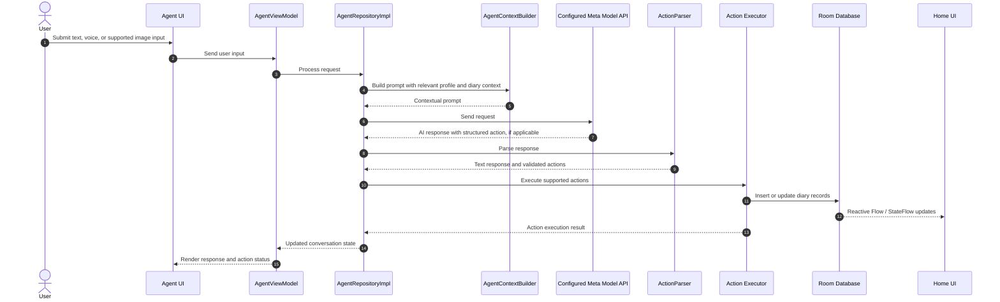

# NutriMind AI 🥗📊
> **Multimodal Personal Nutrition & Activity Tracking Agent Powered by Meta AI**  
> *Submitted to the [Meta Global AI Developer Hackathon 2026](https://meta.ai) — Indie Developer Track*

[](https://developer.android.com)
[](https://kotlinlang.org)
[](https://developer.android.com/jetpack/compose)
[](https://api.meta.ai)
[](https://github.com/FebrianDev/Nutrimind-AI/releases/tag/v1.0.1)
[](https://youtu.be/iHLcYscWxts)
[](LICENSE)

> 🎥 **[Watch Demo Video on YouTube](https://youtu.be/iHLcYscWxts)** &nbsp;|&nbsp; 📥 **[Download APK v1.0.1](https://github.com/FebrianDev/Nutrimind-AI/releases/tag/v1.0.1)**

> [!NOTE]
> **Scope & Non-Medical Utility Notice**: NutriMind AI is a personal nutrition and activity tracking application. It helps users record, organize, and review daily lifestyle data. It does **not** provide medical diagnosis, clinical treatment, eating-disorder intervention, or professional medical advice. Nutritional and energy values are mathematical approximations intended solely for personal tracking and informational purposes.

---

## 🌟 Overview

Unlike generic hackathon chatbots that attempt to give risky, unqualified health advice, **NutriMind AI is engineered strictly as an autonomous tracking agent and cultural data-logging utility**.

It eliminates daily journaling friction by turning multimodal inputs (spoken voice notes, food photos, and natural text) into **direct on-device Room DB mutations via structured tool calling (`json:action`)**. It also directly addresses global AI bias by accurately decomposing regional Southeast Asian dishes (such as Nasi Goreng, Rendang, Gado-Gado, Satay, Soto, and Tempeh) that Western models overlook, backed by an offline-first architecture and secure cloud synchronization.

Traditional tracking workflows often require users to search static databases, estimate portions, and enter each item manually. This cognitive friction frequently leads to tracking fatigue and abandonment. Rather than functioning as a general-purpose conversational chatbot, NutriMind AI connects AI-generated structured actions to an on-device data layer. Supported actions create verified records for food, water, exercise, and body weight, with updates reflected immediately through reactive data flows.

---

## 🚀 Key Features

### 1. Multimodal Personal Tracking Agent
Interact with the tracking agent using natural language and supported multimodal inputs:
- **Natural Language Logging**: Record meals, drinks, workouts, and body weight in English or Indonesian. For example: *"I just ate two boiled eggs and drank 500 ml of water"* or *"Tadi sore lari 30 menit dan minum 400 ml air."*
- **Structured Action Output**: The AI interprets user intent and outputs structured `json:action` directives for supported logging operations.
- **Local Database Execution**: `CoachActionExecutor` processes validated actions and writes supported records directly through the Room data layer, including food intake, water, and exercise entries.
- **Reactive UI Updates**: Kotlin `StateFlow` propagates database changes to relevant parts of the application, such as calorie, macronutrient, and hydration summaries.
- **Action Confirmations**: The conversation UI displays interactive confirmation badges summarizing successfully processed diary actions.
- **Contextual Conversations**: The agent utilizes relevant conversation history and diary context to interpret follow-up requests, such as assigning a previously discussed meal to lunch.
- **Voice Input**: Users can provide spoken entries instead of typing, transcribed via Meta voice endpoints.
- **Image Input**: Users can attach a meal or ingredient photo for supported vision-based analysis and logging workflows.

### 2. Multimodal Food Recognition
- **Camera & Gallery Input**: Capture a meal using CameraX or select an existing image from the device gallery.
- **Food Identification**: The vision workflow identifies visible food items and estimates portions and nutritional values.
- **Meal Component Breakdown**: For mixed dishes, the analysis itemizes visible components such as proteins, carbohydrates, side dishes, and sauces where identifiable.
- **Review Before Saving**: Results are presented in `RecognizedFoodScreen`, where users can review and adjust portions or values before saving them to the diary.
- **Regional Cuisine Support**: Recognition prompts include Indonesian and Southeast Asian dishes such as Nasi Goreng, Gado-Gado, Satay, Rendang, Soto, Tempeh, Tofu, and Pecel.
- **Barcode Scanning**: Google ML Kit barcode scanning integrates with the OpenFoodFacts API for packaged food lookup.
- **Manual & Search Entry**: Users can search for foods or enter custom calorie and macronutrient values directly.

> *Note on Estimation*: Food recognition and portion estimation are approximate. Results may vary with image quality, lighting, ingredients, preparation methods, and serving size. Users should always review and adjust the result before saving it.

### 3. Daily Consistency & Activity History
- **Daily Checklists**: Track daily activities such as logging meals, reaching hydration targets, completing physical activity, and performing daily reviews.
- **Streak Tracking**: View consistency streaks to help maintain a regular tracking habit.
- **Historical Completion**: Review 7-, 30-, and 90-day completion rates, strictly constrained by the account creation date.
- **Activity Journal**: Browse historical food, drink, and exercise entries in a chronological journal.

### 4. Context-Aware Reminders
- **Background Scheduling**: Android `WorkManager` schedules periodic reminders in the background.
- **Hydration Schedule**: Configure reminder intervals (1, 1.5, 2, or 3 hours) within an active daytime window to prevent sleep disturbance.
- **Meal & Daily Review Reminders**: Configure reminder times for breakfast, lunch, dinner, and end-of-day reviews.
- **Intelligent Skip**: Reminder workers check recent logging activity in the local database and suppress reminders when the corresponding entry has already been recorded.

### 5. Daily Intake & Activity Summary
- **Daily Balance Score**: Calculates a daily completion score (0–100) from tracking consistency, macronutrient balance, hydration, and physical activity.
- **AI-Generated Daily Summary**: Generates a concise summary highlighting recorded activity milestones and nutritional balance observations.
- **Home Summary Cards**: Displays contextual summary cards based on current intake and progress toward configured targets.

### 6. Shareable Daily Summary Card
- **Daily Overview**: Creates a visual summary containing the daily score, calorie progress, macronutrients, hydration, workouts, and an AI-generated summary highlight.
- **Off-Screen Rendering**: Uses Jetpack Compose `rememberGraphicsLayer()` and Android `FileProvider` to render and export a clean PNG image.
- **Social Sharing**: Shares the generated card with compatible apps, including messaging and social media platforms.

### 7. Hydration, Physical Activity & Health Connect
- **Hydration Tracking**: Record water with quick increments (+250 ml, +500 ml) and monitor progress toward a daily target.
- **Workout Logging**: Record activities such as walking, running, cycling, strength training, and swimming.
- **Active Energy Estimates**: Track estimated active calories associated with recorded activities using standard MET calculations.
- **Health Connect**: Integrates with Android Health Connect to read supported data such as steps, activities, and active calories, subject to user-granted permissions and device availability.

### 8. Progress Analytics & Weight Journal
- **Progress Trends**: View 7-, 30-, and 90-day charts for calories, protein, carbohydrates, fat, water, weight, and exercise.
- **Weight Journal**: Record and review body weight changes over time.
- **Estimated Weight Trend**: Displays a mathematical weight trend projection based on cumulative recorded energy-balance data. This is an informational estimation based on user logs, not a clinical prediction.
- **Historical Records**: Review past daily entries and meal-level nutrition details.

### 9. Energy Expenditure & Goal Customization
- **Onboarding Flow**: Collects baseline metrics including age, gender, height, weight, activity level, and personal tracking goal.
- **BMR & TDEE Estimates**: Uses the scientifically validated Mifflin-St Jeor equation and activity factors to estimate baseline and daily energy expenditure.
- **Configurable Targets**: Set or adjust calorie and macronutrient targets at any time from the Profile screen.

### 10. Offline-First Architecture & Cloud Synchronization
- **On-Device Single Source of Truth**: Uses local Room Database to deliver instant, zero-latency interactions and full offline tracking capability.
- **Secure Cloud Authentication**: Powered by **Firebase Authentication**, supporting Email/Password sign-in, Google Authentication, and seamless guest-to-permanent account linking.
- **Two-Way Cloud Firestore Synchronization**: `FirestoreSyncRepository` and background `DataSyncWorker` automatically back up and restore 7 collections (daily logs, food intake, water, exercises, weight, chat history, and missions), ensuring multi-device continuity and dependable data restoration.
- **Cloud Storage**: Firebase Storage securely handles photo uploads in the background.
- **AI Network Processing Transparency**: When AI features are invoked, relevant user inputs and contextual diary records are transmitted to the configured Meta Model API endpoints for processing.
- **User Control**: Users maintain full control to review, edit, or delete AI-generated estimates and diary actions both locally and in the cloud.

---

## 🏗️ System Architecture

NutriMind AI follows **Clean Architecture** principles and modern Android development practices, utilizing a presentation layer, domain logic, and a local Room data layer with reactive state updates.

The following sequence illustrates the agent logging workflow:



> *Implementation Note*: The diagram describes the application flow. In the codebase, the execution and parsing components currently use the class identifiers `CoachActionParser` and `CoachActionExecutor`. These identifiers remain in the codebase as internal architecture components; their role in the product architecture is that of an autonomous personal tracking agent.

---

## 🤖 Meta AI Model Ecosystem & Implementation Details

NutriMind AI leverages Meta's multimodal model lineup via the Meta Model API with an automatic cascade fallback mechanism to ensure maximum reliability and latency optimization:

### Model Deployment & Responsibility Matrix

| Model Identifier | Modality | Primary Task & Responsibility | Fallback Cascade | Source Implementation |
| :--- | :--- | :--- | :--- | :--- |
| **`muse-spark-1.3`** | Multimodal (Vision & Text) | Primary endpoint for fast multimodal plate decomposition, regional cuisine identification, and initial nutritional approximation. | `llama-v3p2-11b-vision-instruct`, `llama-v3p2-90b-vision-instruct` | [`MetaAiService.kt`](app/src/main/java/com/fdev/nutrimindai/core/ai/MetaAiService.kt#L49-L56) |
| **`Llama 3.3 70B Instruct`**<br>([`meta/llama-3.3-70b-instruct`](https://huggingface.co/meta-llama/Llama-3.3-70B-Instruct)) | Text & Reasoning | Multi-turn conversational reasoning, intent interpretation, and generating structured `json:action` database directives. | `llama-v3p2-3b-instruct`, `muse-spark-1.3` | [`MetaAiService.kt`](app/src/main/java/com/fdev/nutrimindai/core/ai/MetaAiService.kt#L58-L65) |
| **`Llama 3.2 11B / 90B Vision`**<br>([`meta/llama-3.2-11b-vision-instruct`](https://huggingface.co/meta-llama/Llama-3.2-11B-Vision-Instruct)) | Vision & Multimodal | High-precision multi-item plate decomposition for complex Indonesian dishes (Rendang, Gado-Gado, Soto, Tempeh). | `accounts/fireworks/models/llama-v3p2-11b-vision-instruct` | [`MetaAiService.kt`](app/src/main/java/com/fdev/nutrimindai/core/ai/MetaAiService.kt#L283-L335) |
| **`muse-voice-transcribe-1.0`**<br>(Meta MMS / Voice) | Audio / Speech-to-Text | Hands-free spoken logging in English & Indonesian, transcribing audio notes into text for agent parsing. | Dedicated multipart ASR endpoint | [`MetaAiService.kt`](app/src/main/java/com/fdev/nutrimindai/core/ai/MetaAiService.kt#L539-L638) |

### Direct Links to Meta AI Implementation in Codebase

Judges can inspect the exact implementation of Meta AI models directly through the following source files:

1. **Core Meta AI Client & Fallback Cascade**: [`MetaAiService.kt`](app/src/main/java/com/fdev/nutrimindai/core/ai/MetaAiService.kt)  
   *Manages HTTP communication with Meta Model API endpoints, candidate model cascades, image Base64 serialization, and multipart audio transcription.*
2. **AI Repository & High-Level Contracts**: [`AiRepositoryImpl.kt`](app/src/main/java/com/fdev/nutrimindai/core/ai/AiRepositoryImpl.kt)  
   *Coordinates food image analysis, daily review generation, smart recipe ideas, and multi-turn chat handling between ViewModels and the Meta AI engine.*
3. **Dynamic Prompt & Context Builder**: [`NutriCoachContextBuilder.kt`](app/src/main/java/com/fdev/nutrimindai/feature/coach/domain/NutriCoachContextBuilder.kt)  
   *Constructs the contextual system prompt injected with the user's real-time Room database records, daily targets, and the structured `json:action` schema.*
4. **Autonomous Action Parser**: [`CoachActionParser.kt`](app/src/main/java/com/fdev/nutrimindai/feature/coach/domain/CoachActionParser.kt)  
   *Safely intercepts model outputs, extracts structured JSON action directives, and returns clean conversational text for the UI.*
5. **Database Action Executor**: [`CoachActionExecutor.kt`](app/src/main/java/com/fdev/nutrimindai/feature/coach/domain/CoachActionExecutor.kt)  
   *Executes validated action directives (`LOG_FOOD`, `LOG_WATER`, `LOG_EXERCISE`, `LOG_WEIGHT`) directly into on-device Room DAOs.*
6. **Payload & Response Data Models**: [`MetaAiModels.kt`](app/src/main/java/com/fdev/nutrimindai/core/ai/model/MetaAiModels.kt)  
   *Kotlinx Serialization data classes representing OpenAI-compatible Meta chat completion requests, message payloads, choices, and usage metrics.*

---

## 💻 Tech Stack

| Category | Technologies |
| :--- | :--- |
| **Language & Platform** | Kotlin 2.0, Android SDK (Min SDK 26, Target SDK 37) |
| **UI Framework** | Jetpack Compose, Material 3, Compose Navigation |
| **Typography & Theme** | Bundled Plus Jakarta Sans, Custom Emerald Theme |
| **AI Integration** | Meta Model API (`muse-spark-1.3`, `muse-voice-transcribe-1.0`, or configured endpoints) |
| **Camera & Vision** | CameraX, ML Kit Barcode Scanning, Image Processing |
| **Background Work** | Android WorkManager (Context-Aware Reminders & Intelligent Skip) |
| **Architecture** | Clean Architecture, MVI / MVVM |
| **Local Persistence** | Room Database, DataStore Preferences |
| **Cloud Backend & Sync** | Firebase Authentication, Cloud Firestore, Firebase Storage |
| **Dependency Injection** | Dagger Hilt |
| **Asynchronous Processing** | Kotlin Coroutines, Flow, StateFlow, SharedFlow |
| **Networking** | OkHttp 4, Retrofit 2, Kotlinx Serialization |
| **Health & Fitness** | Android Health Connect API |
| **Image Sharing** | Compose `rememberGraphicsLayer()`, Android `FileProvider` |

---

## 🛠️ Getting Started

### ⚡ Try the Pre-built APK
Download **[NutriMind AI v1.0.1 APK](https://github.com/FebrianDev/Nutrimind-AI/releases/tag/v1.0.1)** from GitHub Releases and install it directly on any compatible Android device (Android 8.0+ / SDK 26+).

#### 👤 Instant Evaluation via Demo Accounts
To make evaluation fast and frictionless for judges without requiring initial data input, the login screen provides ready-to-use **Demo Accounts** (pre-loaded with 14 days of realistic meal logs, hydration records, and exercise history):
- **Pre-populated for Instant Testing**: Allows judges to immediately evaluate the Home dashboard, interactive calorie and macro rings, trend charts, and the autonomous tracking agent without manual setup.
- **Evaluation-Only (Non-Persistent for Personal Use)**: Please note that demo accounts are designed specifically for demonstration and feature evaluation. Data recorded under a demo account is ephemeral and cannot be transferred or saved as a permanent personal account.
- **Testing Real / Personal Tracking**: If you want to use NutriMind AI for authentic daily journaling and personalized biometric targets, tap **Register** on the welcome screen to create a dedicated personal account.

### Prerequisites
- Android Studio Ladybug (2024.2+) or newer.
- Android SDK (API 26+).
- A valid API key for the configured Meta AI provider.

### 1. Clone the Repository
```bash
git clone https://github.com/FebrianDev/Nutrimind-AI.git
cd Nutrimind-AI
```

### 2. Configure Local Properties
Copy the example properties file:
```bash
cp local.properties.example local.properties
```

Add the credentials and model configuration expected by the application:
```properties
sdk.dir=C\:\\Users\\YourUsername\\AppData\\Local\\Android\\Sdk
META_AI_API_KEY=YOUR_META_AI_API_KEY
META_AI_BASE_URL=https://api.meta.ai/v1/
META_AI_VISION_MODEL=muse-spark-1.3
META_AI_TEXT_MODEL=muse-spark-1.3
```
*(Do not commit `local.properties` or API credentials to version control).*

### 3. Run Unit Tests
```bash
./gradlew testDebugUnitTest
```

### 4. Build & Install the Debug App
```bash
./gradlew installDebug
```

---

## 💡 Engineering Challenges

1. **Multi-Component Food Recognition**: Real-world meals often contain several ingredients on a single plate. The vision workflow is designed to identify visible components and estimate their portions and nutritional values. Because image-based estimates involve inherent uncertainty, the app provides an interactive review step (`RecognizedFoodScreen`) before records are committed to the diary.
2. **Validating AI-Generated Actions**: Connecting model outputs to local database operations requires a strict validation boundary. NutriMind AI uses an action parsing and execution flow to interpret supported directives such as `LogFood`, `LogWater`, `LogExercise`, and `LogWeight`. The executor handles supported actions through the local Room data layer, while reactive flows update the UI.  
   *(Note: The codebase uses the class names `CoachActionParser` and `CoachActionExecutor`. These identifiers reflect the internal implementation names, while product positioning and documentation reflect their role as part of the personal tracking agent).*
3. **Reducing Reminder Fatigue**: Frequent or redundant notifications often cause users to disable reminders. WorkManager periodic workers check relevant database activity before posting alerts, suppressing notifications when corresponding entries have already been logged for that time window.

---

## 🔮 What We Learned & What's Next

NutriMind AI explores how multimodal AI and structured action execution can make personal nutrition and activity tracking more convenient. Connecting natural-language and vision inputs directly to an on-device mobile database eliminates the need for users to manually transcribe chat outputs into a separate tracker.

Planned improvements include:
- **In-App Purchases & NutriMind Pro (Google Play Billing)**: Integrating Google Play Billing for premium subscriber tiers, including unlimited multi-device cloud backups, extended historical trend forecasting, and custom data export capabilities.
- **On-Device Inference with ExecuTorch**: Exploring lightweight models running directly on-device via ExecuTorch to reduce network latency and support offline inference for selected workflows.
- **Wear OS Companion**: Exploring Wear OS tiles and complications for quick hydration logging and glanceable daily tracking summaries.

---

## 🏆 Hackathon Information

- **Event**: Meta Global AI Developer Hackathon 2026.
- **Track**: Indie Developer Track.
- **Project**: NutriMind AI — *Multimodal Personal Nutrition & Activity Tracking Agent*.
- **Demo Walkthrough**: **[Watch on YouTube](https://youtu.be/iHLcYscWxts)**.
- **Binary Release**: **[Download APK v1.0.1](https://github.com/FebrianDev/Nutrimind-AI/releases/tag/v1.0.1)**.

> *Scope Clarification*: NutriMind AI uses AI for multimodal input processing and structured personal tracking workflows. Its scope is personal record-keeping and informational summaries, not medical diagnosis or clinical recommendations. The project description is an honest technical overview of the software built; judges and organizers determine eligibility under official event rules.

---

## 📄 License

This project is licensed under the [MIT License](LICENSE) — see the [LICENSE](LICENSE) file for details.
