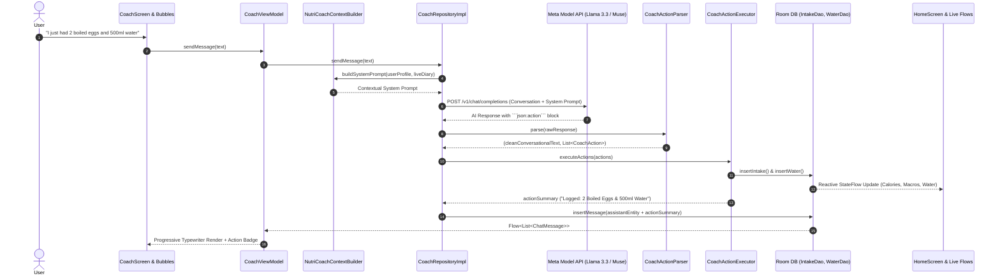

# NutriMind AI 🥗🧠
> **Smart Multimodal Nutrition & Wellness Coach Powered by Meta AI**  
> *Submitted to the [Meta Global AI Developer Hackathon 2026](https://meta.ai) — Indie Developer Track ($400,000 Prize Pool)*

[](https://developer.android.com)
[](https://kotlinlang.org)
[](https://developer.android.com/jetpack/compose)
[](https://api.meta.ai)
[](https://github.com/FebrianDev/Nutrimind-AI/releases/tag/v1.0.1)
[](https://youtu.be/3KouHsuXZmA)
[](LICENSE)

> 🎥 **[Watch Demo Video on YouTube](https://youtu.be/3KouHsuXZmA)** &nbsp;|&nbsp; 📥 **[Download & Test APK (v1.0.1)](https://github.com/FebrianDev/Nutrimind-AI/releases/tag/v1.0.1)**

---

## 🌟 Overview & Problem Statement

Maintaining consistent nutritional mindfulness is one of the most effective ways to improve long-term wellness, yet conventional dietary tracking approaches present significant friction:
1. **Manual logging friction**: Manually searching, weighing, and typing every individual food item creates high daily friction and tracking fatigue.
2. **Cold, static data**: Presenting raw calorie numbers without contextual guidance leaves users guessing how to balance their meals sustainably.
3. **Limited personalized guidance**: Timely, personalized dietary coaching is often inaccessible for everyday users.
4. **Cultural diet mismatch**: Conventional nutrition tools cater predominantly to Western diets, frequently struggling to accurately recognize regional, Asian, and multicultural meals.

**NutriMind AI** transforms nutrition tracking into an effortless, culturally inclusive, and proactive experience by leveraging **Meta's state-of-the-art multimodal AI models** (`Llama 3.2 Vision`, `Llama 3.3 70B`, and `Meta MMS / Voice`). With a photo of your meal, a natural chat message, or a quick voice note, NutriMind AI acts as a dedicated 24/7 personal dietitian in your pocket.

---

## 🚀 Comprehensive Feature Breakdown

### 1. 🤖 Agentic AI NutriCoach (Autonomous Tool Calling & Local DB Logging)
*Transforming conversational AI into an autonomous, proactive nutrition agent.*
- **Natural Language Intent Recognition**: Users can log meals and drinks conversationally in English or Indonesian (e.g., *"I just ate 2 boiled eggs and drank 500ml of water"* or *"Tadi siang makan gado-gado dan minum 400ml air"*).
- **Structured Tool / Action Execution**: Meta's reasoning model identifies user intent, calculates nutritional macros, and outputs a structured `json:action` directive.
- **Autonomous Room Database Mutation**: `CoachActionExecutor` intercepts action directives and automatically writes them to local Room database entities (`IntakeDao`, `WaterDao`).
- **Real-Time Cross-App Synchronization**: Reactive Kotlin `StateFlow` updates propagate instantly across the entire application—the Home calorie ring, macro bars, and hydration levels reflect the new meal immediately.
- **Interactive Action Badges**: Chat bubbles display confirmation pills (e.g., `✅ Logged to Diary: 2 Boiled Eggs (156 kcal) & +500 ml Water`).
- **Full Multimodal Input (Text + Voice + Vision)**: In addition to text and Meta MMS voice recording, NutriCoach natively supports photo attachments directly from the camera or device gallery. Users can snap their fridge ingredients, a physical restaurant menu, or a food plate, and ask the coach for instant dietary advice, healthier alternatives, or autonomous diary logging.
- **Contextual Follow-Up Memory**: NutriCoach maintains conversational multi-turn context. When users follow up on previous advice (e.g., *"Catat makanan tadi ke makan siang"* or *"Log that to my diary"*), the coach remembers the previously discussed nutrition estimates and triggers local database logging seamlessly.
- **Typewriter Streaming & Responsive Chat**: Natural, word-by-word streaming rendering with animated typing indicators and quick suggestion chips.

### 2. 📸 Multimodal Vision Scanner ("Build for Your World")
- **Snap & Recognize**: Capture meal photos directly using CameraX or pick from the device gallery.
- **Multi-Component Plate Decomposition**: Powered by **Meta Llama 3.2 Vision**, the engine itemizes complex plates with multiple ingredients (e.g., proteins, carbohydrates, side dishes, sauces) and provides cumulative calories, macros, and itemized component portion estimates.
- **Interactive Verification & 1-Tap Save**: Analyzed meals are presented in an interactive verification card (`RecognizedFoodScreen`) where users can easily review, adjust portions, and confirm the log to their diary with one tap.
- **Multicultural Cuisine Expertise**: Trained to recognize global cuisines as well as regional Indonesian & Southeast Asian dishes (such as Nasi Goreng, Gado-Gado, Satay, Rendang, Soto, Tempeh, Tofu, and Pecel).
- **Non-Food Defensive Guardrails**: Gracefully handles non-food items (electronics, pets, objects) without crashing or hallucinating calories.
- **Integrated Barcode Scanner**: Fast barcode scanning via Google ML Kit paired with OpenFoodFacts API for packaged groceries.
- **Flexible Manual & Search Entry**: Search database or quickly input custom calories and macros manually.

### 3. 🎯 Daily Missions & Gamified Habit Building
- **Interactive Daily Missions**: Daily wellness checklists (e.g., Log Breakfast, Reach Daily Protein Target, Hit Hydration Goal, Complete Workout, Daily Review) that turn healthy habits into rewarding daily wins.
- **Streak & Consistency Tracking**: Tracks continuous adherence streaks to boost intrinsic motivation and prevent tracking abandonment.
- **Comprehensive Mission History**: Dedicated historical dashboard displaying 7, 30, and 90-day completion rates, strictly and accurately constrained to the user's account creation date.

### 4. ⏰ Context-Aware Smart Reminders & Intelligent Skip
- **Automated Background Scheduling**: Powered by Android `WorkManager` with full support for Android 13+ runtime notification permissions.
- **Customizable Hydration Schedule**: Configurable interval reminders (1h, 1.5h, 2h, 3h) with an active daytime window (e.g., 08:00 – 21:00) so users are never disturbed during sleep.
- **Meal & Evening Review Reminders**: Timely alerts for Breakfast, Lunch, Dinner, and End-of-Day Review with native Compose time pickers.
- **Intelligent Smart Skip**: Automatically suppresses reminders if the user has already logged their intake for that period, eliminating repetitive and annoying notification fatigue.
- **In-App Notification Test Suite**: Built-in debug controls to test water and meal notifications instantly.

### 5. 📊 Daily AI Evaluation & Proactive Coaching Tips
- **End-of-Day Trajectory Scoring**: Calculates a holistic Health Score (0–100) based on calorie adherence, macro balance, hydration, and physical activity.
- **Meta AI Review Summary**: Generates a motivating 3-sentence evaluation highlighting daily achievements and actionable improvements for tomorrow.
- **Dynamic Home Coaching Banner**: Real-time micro-tips generated by Meta AI displayed right on the home dashboard based on current intake and goal progress.

### 6. 🎨 Shareable Luxury Health Milestone Card
- **Social Media Ready**: Generates an aesthetic dark-emerald visual score card displaying:
  - Daily Health Trajectory Score (0–100)
  - Calorie Budget Progress (Consumed vs. Target)
  - Macronutrient Breakdown (Protein, Carbs, Fat)
  - Hydration level & Workouts completed
  - Personalized Meta AI Coach feedback highlight & official watermark
- **High-Resolution Off-Screen Rendering**: Leverages Jetpack Compose `rememberGraphicsLayer()` and Android `FileProvider` for crisp PNG captures.
- **1-Click Social Sharing**: Direct sharing to Instagram Stories, WhatsApp, Twitter/X, and other apps.

### 7. 💧 Hydration, Physical Activity & Health Connect
- **Interactive Hydration Tracker**: Visual bottle fill progress with quick-log increments (+250ml, +500ml) and dynamic daily target monitoring.
- **Workout & Active Burn Logging**: Log physical activities (Walking, Running, Cycling, Strength Training, Swimming, etc.) with active calorie burn calculations dynamically adjusting net daily energy balance.
- **Android Health Connect Integration**: Native synchronization with Android Health Connect to automatically import daily step counts, smartwatch activities, and active calories burned directly into the daily journal and Home dashboard energy ring.

### 8. 📈 Progress Analytics, Trends & Body Weight Forecasting
- **Science-Backed Weight Forecasting**: Mathematical projection of body weight changes based on cumulative caloric deficits or surpluses over time.
- **Interactive Multi-Metric Trends**: Comprehensive 7, 30, and 90-day progress charts for Calories, Protein, Carbs, Fat, Water, Weight, and Exercise.
- **Historical Activity Journal**: Chronological log of past daily entries with individual meal breakdowns and nutritional summaries.

### 9. 🎯 Science-Backed Onboarding & Goal Customization
- **5-Step Onboarding Flow**: Captures user metrics (Age, Gender, Height, Weight, Activity Level, Target Goal).
- **Mifflin-St Jeor BMR & TDEE Calculation**: Calculates scientifically validated baseline metabolic rate and recommended macro distributions (Weight Loss, Muscle Gain, Maintenance).
- **Customizable Goals**: Adjust calorie and macronutrient targets at any time via Goal Settings in the Profile screen.

### 10. 🔒 Local-First Architecture & Privacy by Design
- **Local SQLite / Room Database**: All meal logs, water entries, biometrics, and activity records are stored locally on-device using Room Database v15.
- **Full Offline Usability**: The app remains fully functional for browsing past logs, tracking water, and viewing trends without an active internet connection.
- **Privacy-Conscious**: No user personal data or meal history is ever monetized or sold.

---

## 🏗️ System & Agentic Architecture

NutriMind AI follows **Clean Architecture** and **Modern Android Development (MAD)** standards with unidirectional data flow (MVI/MVVM).



---

## 💻 Tech Stack & Engineering Highlights

| Category | Technologies |
| :--- | :--- |
| **Language & Platform** | Kotlin 2.0, Android SDK 37 (Min SDK 26, Target SDK 37) |
| **UI Framework** | Jetpack Compose, Material 3, Compose Navigation |
| **Design & Typography** | Bundled Plus Jakarta Sans, Custom Luxury Emerald Theme |
| **AI Engine** | Meta Model API (`muse-spark-1.3`, `Llama 3.2 11B/90B Vision`, `Llama 3.3 70B`) |
| **Computer Vision** | CameraX, ML Kit Barcode Scanning, Base64 JPEG Image Compressor |
| **Background Processing** | Android WorkManager (Smart Reminders & Intelligent Skip) |
| **Architecture** | Clean Architecture (Presentation, Domain, Data), MVI / MVVM |
| **Persistence** | Room Database v15 with auto schema migration, DataStore Preferences |
| **Dependency Injection**| Dagger Hilt |
| **Asynchronous** | Kotlin Coroutines, StateFlow, SharedFlow |
| **Networking** | OkHttp 4, Retrofit 2, Kotlinx Serialization, Bearer Auth Redaction |
| **Health & Fitness** | Android Health Connect API (Steps, Active Calories, Smartwatch sync) |
| **Sharing Engine** | Compose `rememberGraphicsLayer()`, Android `FileProvider` |

---

## 🛠️ Getting Started & Installation

### ⚡ Quick Try (Pre-built APK)
For judges and users who want to try NutriMind AI immediately without building from source:
👉 **[Download NutriMind AI v1.0.1 APK](https://github.com/FebrianDev/Nutrimind-AI/releases/tag/v1.0.1)** and install directly on any Android device (Android 8.0+ / SDK 26+).

### Prerequisites (For Building from Source)
- Android Studio Ladybug (2024.2+) or newer.
- Android SDK 35 / 37 (Minimum SDK 26, Target SDK 37).
- A valid Meta AI / Meta Model API Key.

### 1. Clone the Repository
```bash
git clone https://github.com/FebrianDev/Nutrimind-AI.git
cd Nutrimind-AI
```

### 2. Configure Meta AI API Key
Copy the example properties template:
```bash
cp local.properties.example local.properties
```

Edit `local.properties` and add your Meta AI credentials:
```properties
sdk.dir=C\:\\Users\\YourUsername\\AppData\\Local\\Android\\Sdk
META_AI_API_KEY=YOUR_META_AI_API_KEY
META_AI_BASE_URL=https://api.meta.ai/v1/
META_AI_VISION_MODEL=muse-spark-1.3
META_AI_TEXT_MODEL=muse-spark-1.3
```
*(Note: Fireworks AI or official Meta inference endpoints can be used interchangeably).*

### 3. Run Unit Tests
```bash
./gradlew testDebugUnitTest
```

### 4. Build & Install Debug APK
```bash
./gradlew installDebug
```

---

## 💡 Challenges We Overcame

1. **Complex Multi-Component Plate Estimation**: Food often comes mixed together on a single plate rather than as isolated ingredients. We refined prompts with structured JSON schemas and portion bounds to help the vision model identify distinct meal components and generate realistic nutritional estimates without crashing on ambiguous inputs.
2. **Safe Autonomous Tool Execution**: Connecting conversational LLM outputs to local database mutations requires strict reliability. We engineered `CoachActionParser` and `CoachActionExecutor` to extract validated structured directives (`LogFood`, `LogWater`, `LogExercise`, `LogWeight`) and safely commit them to Room DB, ensuring immediate UI responsiveness through reactive StateFlows without hallucinations or UI freezes.
3. **Preventing Reminder Fatigue**: Users often disable notifications if they trigger redundantly. We implemented intelligent checks in our WorkManager periodic workers to verify recent intake before scheduling alerts, maintaining a non-intrusive user experience.

---

## 🔮 What We Learned & What's Next

Building NutriMind AI demonstrated how Meta's vision and reasoning models can bridge the gap between passive food tracking and an active, empathetic lifestyle companion.

Moving forward, our roadmap includes:
- **On-Device Inference via ExecuTorch**: Bringing lightweight Llama 3.2 models directly onto Android devices using ExecuTorch for zero-latency, privacy-centric offline nutrition logging.
- **Wear OS Companion Extension**: Developing dedicated Wear OS tiles and complications for glanceable calorie rings and 1-tap wrist hydration logging.

---

## 🏆 Hackathon Compliance & Criteria

- **Track**: Meta Global AI Developer Hackathon 2026 — *Indie Developer Track*.
- **Impact (30%)**: Solves real-world daily nutrition adherence, eliminates tedious manual logging, and democratizes expert dietary coaching.
- **Use of Meta AI Tooling (25%)**: Deeply integrated with **Meta Model API**, leveraging **Meta Llama 3.2 Vision** for complex plate decomposition and **Meta Llama 3.3 70B / Muse** for autonomous agentic tool calling and contextual reasoning.
- **Demo & UX (25%)**: Smooth Material 3 interface, progressive typewriter rendering, off-screen milestone sharing card, and zero user friction. Watch the **[YouTube Video Walkthrough](https://youtu.be/3KouHsuXZmA)**.
- **Technical Depth (20%)**: Clean Architecture, autonomous database action execution, Room persistence, reactive StateFlow updates, WorkManager smart reminders, and comprehensive unit test coverage.
- **Judge-Friendly Access**: 100% free and frictionless judge testing with zero paywalls or subscription barriers. Pre-built binary available via **[GitHub Release v1.0.1](https://github.com/FebrianDev/Nutrimind-AI/releases/tag/v1.0.1)**.

---

## 📄 License

This project is licensed under the [MIT License](LICENSE) — see the [LICENSE](LICENSE) file for details.
