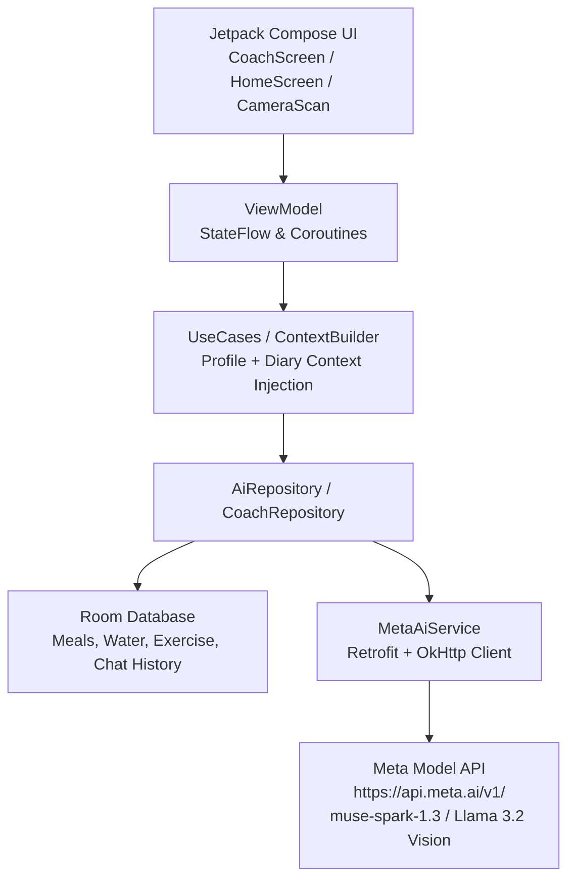

# NutriMind AI 🥗🧠
> **Smart Multimodal Nutrition & Wellness Coach Powered by Meta AI**  
> *Submitted to the [Meta Global AI Developer Hackathon 2026](https://meta.ai) — Indie Developer Track ($400,000 Prize Pool)*

[](https://developer.android.com)
[](https://kotlinlang.org)
[](https://developer.android.com/jetpack/compose)
[](https://api.meta.ai)
[](LICENSE)

---

## 🌟 Overview & Problem Statement

Traditional calorie and macro tracking applications (like MyFitnessPal or LoseIt) suffer from high user churn:
1. **Manual logging friction**: Typing every single ingredient and portion size is tedious and frustrating.
2. **Cold, generic data**: Showing raw calorie numbers does not teach users *how* to build sustainable eating habits.
3. **No personalized coaching**: Most apps lock actionable nutritional insights behind costly subscription paywalls.

**NutriMind AI** eliminates logging friction and provides continuous, context-aware personalized nutrition guidance by leveraging **Meta's state-of-the-art AI models** (`Llama 3.2 Vision` and `Muse Reasoning Models`). With a snap of a camera and real-time conversational chat, NutriMind AI acts as a dedicated 24/7 personal dietitian in your pocket.

---

## 🚀 Key Features Powered by Meta AI

### 1. 📸 One-Shot Food Recognition (Meta Llama 3.2 Vision)
- Snap a photo or choose an image from your gallery.
- Powered by `muse-spark-1.3` / `Llama 3.2 11B Vision Instruct`.
- Instantly estimates:
  - Food Name & Description
  - Estimated Serving Size (grams/portions)
  - Calories (kcal), Protein (g), Carbohydrates (g), and Fat (g)
  - Micronutrient and dietary balance notes
- 1-click addition to today's Breakfast, Lunch, Dinner, or Snack diary.

### 2. 💬 NutriCoach: Context-Aware Conversational AI
- Chat directly with **NutriCoach** about what to eat, cravings, recipe suggestions, and macro adjustments.
- **Dynamic Context Injection (`NutriCoachContextBuilder`)**:
  - Automatically injects the user's live profile (calorie goals, target macros, current weight).
  - Supplies real-time daily logs (consumed calories so far, remaining budget, today's logged meals).
  - Supplies current hydration level and workout energy burned.
- Supports multi-turn dialogue with local persistence in SQLite / Room Database.

### 3. 📊 Daily AI Review & Evaluation
- At the end of each day, NutriMind AI evaluates your entire nutrition, hydration, and activity trajectory.
- Generates a holistic health score (0–100) and actionable feedback highlighting what went well and what to improve tomorrow.

### 4. 💡 Proactive Coaching Insights
- Dynamic daily coaching insight card directly on the home dashboard.
- Context-sensitive advice based on how much calorie budget remains and user fitness targets.

### 5. 💧 Hydration & Fitness Logging
- Quick-log hydration tracker with visual bottle progress.
- Exercise and active calorie burn tracking (Walking, Running, Cycling, Strength Training).

---

## 🏗️ System Architecture

NutriMind AI follows **Clean Architecture** and **Modern Android Development (MAD)** standards with unidirectional data flow (MVI/MVVM).



### Tech Stack Details
- **UI & Toolkit**: Jetpack Compose, Material 3, Compose Navigation.
- **Dependency Injection**: Hilt (Dagger).
- **Asynchronous & Reactive**: Kotlin Coroutines, StateFlow, SharedFlow.
- **Local Persistence**: Room Database v10 with automated schema export.
- **Preferences**: Jetpack DataStore Preferences.
- **Networking**: Retrofit 2, OkHttp 4 (Logging Interceptors, custom SSE/JSON parsing), Kotlinx Serialization.
- **Image Processing**: Android CameraX, Bitmap downscaling/compression, Base64 URI encoding for Meta Vision payload.
- **Architecture**: Clean Architecture (Presentation, Domain, Data layers).

---

## 🛠️ Getting Started & Installation

### Prerequisites
- Android Studio Ladybug (2024.2+) or newer.
- Android SDK 35 / 37 (Minimum SDK 24, Target SDK 37).
- A valid Meta AI / Meta Model API Key.

### 1. Clone the Repository
```bash
git clone https://github.com/FebrianDev/Nutrimind-AI.git
cd Nutrimind-AI
```

### 2. Configure Meta AI API Key
Copy the example properties template:
```bash
cp local.properties.example local.properties
```

Edit `local.properties` and add your Meta AI credentials:
```properties
sdk.dir=C\:\\Users\\YourUsername\\AppData\\Local\\Android\\Sdk
META_AI_API_KEY=YOUR_META_AI_API_KEY
META_AI_BASE_URL=https://api.meta.ai/v1/
META_AI_VISION_MODEL=muse-spark-1.3
META_AI_TEXT_MODEL=muse-spark-1.3
```

### 3. Run Unit Tests
```bash
./gradlew testDebugUnitTest
```

### 4. Build & Install Debug APK
```bash
./gradlew installDebug
```

---

## 🏆 Hackathon Compliance & Criteria

- **Track**: Meta Global AI Developer Hackathon 2026 — *Indie Developer Track*.
- **Impact (30%)**: Solves real-world daily nutrition adherence and makes dietary guidance accessible to anyone.
- **Use of Meta AI Tooling (25%)**: Built from the ground up around the official **Meta Model API** using multimodal Llama 3.2 Vision for instant food analysis and Muse reasoning models for dynamic context-aware coaching.
- **Demo & UX (25%)**: Polished Material 3 design, fluid animations, pulse typing indicators, and zero friction.
- **Technical Depth (20%)**: Full Clean Architecture, Room database persistence, offline-first data layer, optimized token budgeting, and 100% passing unit test coverage.
- **Judge-Friendly Access**: Zero paywalls, zero account locking, frictionless judge testing.

---

## 📄 License

This project is licensed under the [MIT License](LICENSE) — see the LICENSE file for details.
