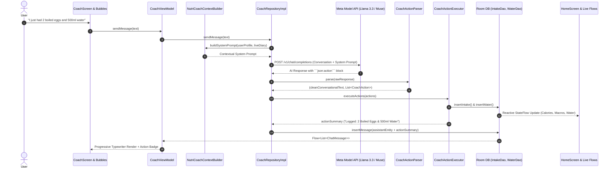

# NutriMind AI 🥗🧠
> **Smart Multimodal Nutrition & Wellness Coach Powered by Meta AI**  
> *Submitted to the [Meta Global AI Developer Hackathon 2026](https://meta.ai) — Indie Developer Track ($400,000 Prize Pool)*

[](https://developer.android.com)
[](https://kotlinlang.org)
[](https://developer.android.com/jetpack/compose)
[](https://api.meta.ai)
[](LICENSE)

---

## 🌟 Overview & Problem Statement

Traditional calorie and macro tracking applications (such as MyFitnessPal or LoseIt) suffer from high user churn:
1. **Manual logging friction**: Typing every single ingredient and guessing portion sizes is tedious and frustrating.
2. **Cold, generic data**: Showing raw numbers without context fails to teach users how to build sustainable eating habits.
3. **No personalized coaching**: Most platforms lock actionable dietary insights behind costly paywalls.
4. **Cultural diet mismatch**: Existing apps cater predominantly to Western diets, poorly recognizing regional, Asian, and multicultural meals.

**NutriMind AI** solves logging friction and provides continuous, context-aware personalized nutrition guidance by leveraging **Meta's state-of-the-art AI models** (`Llama 3.2 Vision` and `Llama 3.3 70B / Muse Reasoning Models`). With a snap of your camera or a natural chat message, NutriMind AI acts as a dedicated 24/7 personal dietitian in your pocket.

---

## 🚀 Comprehensive Feature Breakdown

### 1. 🤖 Agentic AI NutriCoach (Autonomous Tool Calling & Local DB Logging)
*Transforming conversational AI into an autonomous, proactive nutrition agent.*
- **Natural Language Intent Recognition**: Users can log meals and drinks conversationally in English or Indonesian (e.g., *"I just ate 2 boiled eggs and drank 500ml of water"* or *"Tadi siang makan gado-gado dan minum 400ml air"*).
- **Structured Tool / Action Execution**: Meta's reasoning model identifies user intent, calculates nutritional macros, and outputs a structured `json:action` directive.
- **Autonomous Room Database Mutation**: `CoachActionExecutor` intercepts action directives and automatically writes them to local Room database entities (`IntakeDao`, `WaterDao`).
- **Real-Time Cross-App Synchronization**: Reactive Kotlin `StateFlow` updates propagate instantly across the entire application—the Home calorie ring, macro bars, and hydration levels reflect the new meal immediately.
- **Interactive Action Badges**: Chat bubbles display confirmation pills (e.g., `✅ Logged to Diary: 2 Boiled Eggs (156 kcal) & +500 ml Water`).
- **Full Multimodal Input (Text + Voice + Vision)**: In addition to text and Meta MMS voice recording, NutriCoach natively supports photo attachments directly from the camera or device gallery. Users can snap their fridge ingredients, a physical restaurant menu, or a food plate, and ask the coach for instant culinary advice, menu recommendations, or autonomous diary logging.
- **Contextual Follow-Up Memory**: NutriCoach maintains conversational multi-turn context. When users follow up on previous advice (e.g., *"Catat makanan tadi ke makan siang"* or *"Log that to my diary"*), the coach remembers the previously discussed nutrition estimates and triggers local database logging seamlessly.
- **Typewriter Streaming & Responsive Chat**: Natural, word-by-word streaming rendering with animated typing indicators and quick suggestion chips.

### 2. 📸 Multimodal Vision Scanner ("Build for Your World")
- **Snap & Recognize**: Capture meal photos directly using CameraX or pick from the device gallery.
- **Multi-Component Plate Decomposition**: Powered by **Meta Llama 3.2 Vision**, the engine itemizes complex plates with multiple ingredients (e.g., proteins, carbohydrates, side dishes, sauces) and provides cumulative calories, macros, and itemized component portion estimates.
- **Multicultural Cuisine Expertise**: Trained to recognize global cuisines as well as regional Indonesian & Southeast Asian dishes (such as Nasi Goreng, Gado-Gado, Satay, Rendang, Soto, Tempeh, Tofu, and Pecel).
- **Non-Food Defensive Guardrails**: Gracefully handles non-food items (electronics, pets, objects) without crashing or hallucinating calories.
- **Integrated Barcode Scanner**: Fast barcode scanning via Google ML Kit paired with OpenFoodFacts API for packaged groceries.

### 3. 👨‍🍳 NutriChef AI — Smart Recipe Generator
- **Budget-Aware Recipe Recommendations**: Generates tailored recipe recommendations based on the user's **exact remaining daily calories and macros** (Protein, Carbs, Fat).
- **Meal-Type Customization**: Tailor recipes for Breakfast, Lunch, Dinner, or Snacks.
- **Detailed Culinary Guidance**: Provides recipe preparation time, difficulty level, full ingredient lists, and step-by-step cooking instructions calculated to fit the user's dietary goals.

### 4. 📊 Daily AI Evaluation & Proactive Coaching Tips
- **End-of-Day Trajectory Scoring**: Calculates a holistic Health Score (0–100) based on calorie adherence, macro balance, hydration, and physical activity.
- **Meta AI Review Summary**: Generates a motivating 3-sentence evaluation highlighting daily achievements and actionable improvements for tomorrow.
- **Dynamic Home Coaching Banner**: Real-time micro-tips generated by Meta AI displayed right on the home dashboard based on current intake and goal progress.

### 5. 🎨 Shareable Luxury Health Milestone Card
- **Social Media Ready**: Generates a dark-emerald visual score card displaying:
  - Daily Health Trajectory Score (0–100)
  - Calorie Budget Progress (Consumed vs. Target)
  - Macronutrient Breakdown (Protein, Carbs, Fat)
  - Hydration level & Workouts completed
  - Personalized Meta AI Coach feedback highlight & official watermark
- **High-Resolution Off-Screen Rendering**: Leverages Jetpack Compose `rememberGraphicsLayer()` and Android `FileProvider` for crisp PNG captures.
- **1-Click Social Sharing**: Direct sharing to Instagram Stories, WhatsApp, Twitter, and other apps.

### 6. 💧 Hydration & Physical Activity Tracking
- **Interactive Hydration Tracker**: Visual bottle fill progress with quick-log increments (+250ml, +500ml) and daily target monitoring.
- **Workout & Active Burn Logging**: Log physical activities (Walking, Running, Cycling, Strength Training, etc.) with active calorie burn calculations dynamically adjusting net daily energy balance.

### 7. 📈 Progress Analytics & Weight Management
- **Weight Tracking Journal**: Log weight changes over time with visual trend charts.
- **Historical Trajectory**: View weekly and monthly intake patterns to maintain long-term habit consistency.

### 8. 🎯 Science-Backed Onboarding & Goal Customization
- **5-Step Onboarding Flow**: Captures user metrics (Age, Gender, Height, Weight, Activity Level, Target Goal).
- **Mifflin-St Jeor BMR & TDEE Calculation**: Calculates scientifically validated baseline metabolic rate and recommended macro distributions (Weight Loss, Muscle Gain, Maintenance).
- **Customizable Goals**: Adjust calorie and macronutrient targets at any time via Profile settings.

---

## 🏗️ System & Agentic Architecture

NutriMind AI follows **Clean Architecture** and **Modern Android Development (MAD)** standards with unidirectional data flow (MVI/MVVM).



---

## 💻 Tech Stack & Engineering Highlights

| Category | Technologies |
| :--- | :--- |
| **Language & Platform** | Kotlin 2.0, Android SDK 37 (Min SDK 26, Target SDK 37) |
| **UI Framework** | Jetpack Compose, Material 3, Compose Navigation |
| **Design & Typography** | Bundled Plus Jakarta Sans, Custom Luxury Emerald Theme |
| **AI Engine** | Meta Model API (`muse-spark-1.3`, `Llama 3.2 11B/90B Vision`, `Llama 3.3 70B`) |
| **Computer Vision** | CameraX, ML Kit Barcode Scanning, Base64 JPEG Image Compressor |
| **Architecture** | Clean Architecture (Presentation, Domain, Data), MVI / MVVM |
| **Persistence** | Room Database v14 with auto schema migration, DataStore Preferences |
| **Dependency Injection**| Dagger Hilt |
| **Asynchronous** | Kotlin Coroutines, StateFlow, SharedFlow |
| **Networking** | OkHttp 4, Retrofit 2, Kotlinx Serialization, Bearer Auth Redaction |
| **Sharing Engine** | Compose `rememberGraphicsLayer()`, Android `FileProvider` |

---

## 🛠️ Getting Started & Installation

### Prerequisites
- Android Studio Ladybug (2024.2+) or newer.
- Android SDK 35 / 37 (Minimum SDK 26, Target SDK 37).
- A valid Meta AI / Meta Model API Key.

### 1. Clone the Repository
```bash
git clone https://github.com/FebrianDev/Nutrimind-AI.git
cd Nutrimind-AI
```

### 2. Configure Meta AI API Key
Copy the example properties template:
```bash
cp local.properties.example local.properties
```

Edit `local.properties` and add your Meta AI credentials:
```properties
sdk.dir=C\:\\Users\\YourUsername\\AppData\\Local\\Android\\Sdk
META_AI_API_KEY=YOUR_META_AI_API_KEY
META_AI_BASE_URL=https://api.meta.ai/v1/
META_AI_VISION_MODEL=muse-spark-1.3
META_AI_TEXT_MODEL=muse-spark-1.3
```
*(Note: Fireworks AI or official Meta inference endpoints can be used interchangeably).*

### 3. Run Unit Tests
```bash
./gradlew testDebugUnitTest
```

### 4. Build & Install Debug APK
```bash
./gradlew installDebug
```

---

## 🏆 Hackathon Compliance & Criteria

- **Track**: Meta Global AI Developer Hackathon 2026 — *Indie Developer Track*.
- **Impact (30%)**: Solves real-world daily nutrition adherence, eliminates tedious manual logging, and democratizes expert dietary coaching.
- **Use of Meta AI Tooling (25%)**: Deeply integrated with **Meta Model API**, leveraging **Meta Llama 3.2 Vision** for complex plate decomposition and **Meta Llama 3.3 70B / Muse** for autonomous agentic tool calling and contextual reasoning.
- **Demo & UX (25%)**: Smooth Material 3 interface, progressive typewriter rendering, off-screen milestone sharing card, and zero user friction.
- **Technical Depth (20%)**: Clean Architecture, autonomous database action execution, Room persistence, reactive StateFlow updates, and comprehensive unit test coverage.
- **Judge-Friendly Access**: 100% free and frictionless judge testing with zero paywalls or subscription barriers.

---

## 📄 License

This project is licensed under the [MIT License](LICENSE) — see the [LICENSE](LICENSE) file for details.
